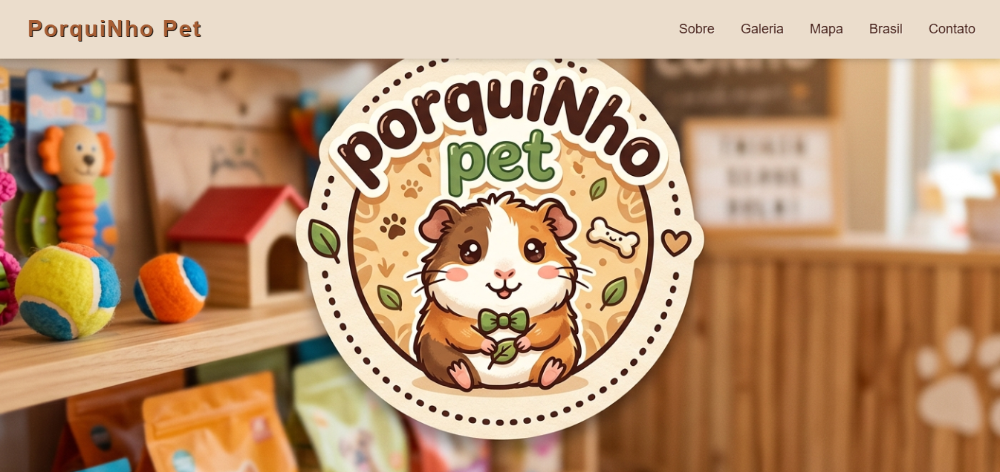

# 🐹 PorquiNho Pet

Site desenvolvido para uma loja fictícia de produtos e roupinhas para animais de estimação, com destaque para uma coleção temática de roupas para porquinhos-da-índia.

## Prévia do projeto



## 📌 Sobre o projeto

O PorquiNho Pet é um projeto de desenvolvimento web que apresenta uma loja fictícia com identidade visual acolhedora. O site reúne informações sobre a loja, galeria de imagens, localização e uma coleção especial de roupinhas inspiradas no Brasil.

## ✨ Seções do site

- **Sobre:** apresentação da loja e sua proposta.
- **Galeria:** imagens do ambiente da loja.
- **Mapa:** localização ilustrativa.
- **Coleção Brasil:** apresentação de cinco modelos de roupinhas.
- **Contato:** formulário visual para preenchimento de mensagens.

## 🛠️ Tecnologias utilizadas

- HTML5
- CSS3

## 👕 Coleção de roupas

O projeto apresenta cinco modelos:

1. Suéter Brasil
2. Vestido Samba
3. Capa de Chuva
4. Regata Seleção
5. Bandana do Brasil

## 🚀 Como visualizar o projeto

1. Faça o download ou clone este repositório.
   Clone o repositório:
   ```bash
   git clone https://github.com/ana-julia-an/porquinho-pet.git
   
2. Abra o arquivo `index.html` no navegador.
3. Navegue pelas seções para conhecer o projeto.

## ⚠️ Observações

Este é um projeto demonstrativo. Os botões de compra e o formulário de contato ainda não estão conectados a serviços funcionais.

## 👩‍💻 Autoria

Desenvolvido por **Ana Júlia Andrade**.

Link para visualizar o site: https://ana-julia-an.github.io/porquinho-pet/ 

Projeto acadêmico desenvolvido para praticar HTML e CSS.
